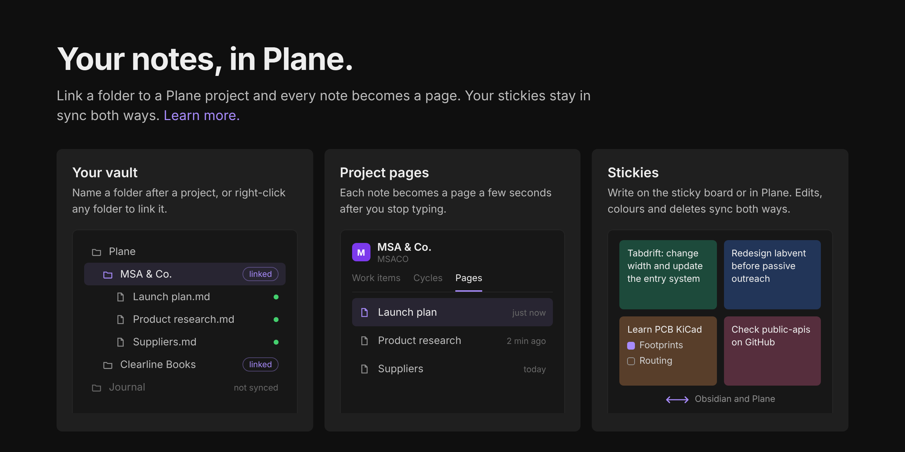

# Plane Sync

Write in Obsidian, work in [Plane](https://plane.so). Link a folder to a Plane project and every note in it becomes a page. Your Plane stickies stay in sync with Obsidian both ways.



```
Plane/
  Clearline Books/        -> Plane project "Clearline Books"
    Architecture.md       -> page "Architecture"
    Onboarding flow.md    -> page "Onboarding flow"
  HOLD/                   -> project with identifier HOLD
    Retention rules.md
```

Requires Obsidian 1.13.2 or later. Works on desktop and mobile.

## Install

### With BRAT (recommended until the plugin is in the community directory)

1. Install **BRAT** from Settings > Community plugins > Browse, and enable it.
2. Run the command **BRAT: Add a beta plugin for testing**.
3. Paste `https://github.com/abdullahwaqar/obsidian-plane-sync` and confirm.

BRAT installs the latest release and keeps it updated.

### Manually

1. Download `main.js`, `manifest.json` and `styles.css` from the [latest release](https://github.com/abdullahwaqar/obsidian-plane-sync/releases/latest).
2. Put them in `<your vault>/.obsidian/plugins/plane-sync/`.
3. Reload Obsidian and enable **Plane Sync** under Settings > Community plugins.

## Set up

Open Settings > Plane Sync:

1. **Personal access token**: create one in Plane under Profile settings > Personal access tokens, then add it here. It's stored in Obsidian's secret storage, not in the plugin's data file.
2. **Workspace**: your workspace slug. Pasting any Plane link from that workspace also works.
3. **Self-hosted Plane**: turn on and fill in **Instance URL** if you're not on app.plane.so.
4. Click **Check connection**.

## Link folders to projects

Use whichever feels natural:

- **Name it.** Create `Plane/<Project name>` or `Plane/<IDENTIFIER>`. The first note you save there links the folder automatically.
- **Command palette:** "Create folder for a project" lists your projects and makes the folder for you.
- **Right-click any folder** in the file explorer and choose "Link to Plane project…". Subfolders inherit the link.
- **Settings:** "Linked folders" shows every link. Click a row to change its project.

## Day to day

- Write. With **Sync on save** on, a note is pushed a few seconds after you stop typing. The status bar shows `Plane: syncing 1`, then `Plane: synced`.
- The first push adds `plane_page` and `plane_project` to the note's properties. That's how the note remembers its page, so renames and moves keep working.
- Renaming a note renames the page.
- Moving a note to a folder linked to another project creates a page there and archives the old one, since Plane can't move pages between projects.
- Deleting a note archives its page. You can change this in settings.
- Click the status bar item to push everything. If it says `Plane: error`, click it to see why.

Commands: push current note, push all linked folders, open or copy the Plane link, and stop syncing the current note (sets `plane_sync: false`).

## Stickies

Your Plane stickies and a folder of notes stay in sync, both ways.

- Open the board with the sticky note icon in the left ribbon, or the command **Open sticky board**. It shows each sticky as a coloured card you can type in, recolour and delete.
- Each sticky is also a note in `Plane/Stickies` (change the folder in settings). Stickies made on the board, or notes with a `plane_color` property in that folder, sync. Other notes there, like index notes from other plugins, are ignored.
- Edits in Obsidian reach Plane a couple of seconds after you stop typing. Edits made in Plane arrive every 2 minutes, when you switch back to Obsidian, or straight away with **Sync stickies now**.
- Colours match Plane's eight sticky colours. Deleting a sticky on either side deletes it on the other.
- If a sticky changed in both places since the last sync, the newer version wins and the other is saved in `Plane/Stickies/Conflicts/` as a plain note, so nothing is lost.
- If a sync run looks wrong (several conflicts at once, or lots of new stickies in a minute), sticky sync pauses itself and tells you why. **Clean up duplicate stickies** finds and removes leftover copies after showing you the list.
- Plane only shows each person their own stickies, so you'll see the stickies of the account your token belongs to.

## What converts

| Obsidian | Plane |
|---|---|
| Headings, bold, italic, strikethrough, code, code blocks, quotes, tables, `---` | Native equivalents |
| `- [ ]` and `- [x]` | Plane checklist |
| `> [!warning] Title` callouts | Plane callout block with a matching emoji and colour |
| `[[Other note]]` | Link to that note's Plane page once it's synced, otherwise plain text |
| `==highlight==` | Bold |
| `%% comments %%` and frontmatter | Dropped |
| Raw HTML | Shown as text, never injected |
| `![[image.png]]` (local files) | Placeholder text, see limitations |

## Limitations

- **Pages sync one way, Obsidian to Plane.** (Stickies sync both ways.) Edits made to a page in Plane are overwritten the next time that note is pushed. Treat Obsidian as the source of truth, or lock a page in Plane to freeze it (the plugin tells you when a page is locked).
- Local images and attachments aren't uploaded yet. Remote image links (``) work.
- Subfolders map to the same project, but pages are flat in Plane.
- Plane allows 60 API requests a minute. The plugin queues and spaces requests, so a first sync of a big folder takes about a second per note.

## Privacy and network use

- The plugin only talks to the Plane API: `api.plane.so`, or your own instance URL if you're self-hosted.
- It sends the title and content of notes inside linked folders, and the content of your sticky notes. Nothing else from your vault is read or sent.
- No analytics, telemetry or third-party services.
- Your token stays in Obsidian's secret storage.

## Development

```bash
npm install
npm run dev           # rebuilds main.js on every save
npm run check         # format check, Biome, Obsidian's review lint, type check, tests
npm run build         # production build
npm run format        # dprint: 4 spaces, braces on the next line
```

To try changes in a vault, link the project folder into `<vault>/.obsidian/plugins/plane-sync` and install the Hot Reload plugin.

Tooling:

- **dprint** formats the code. Biome's formatter can't put braces on the next line, so it's turned off.
- **Biome** lints and sorts imports.
- **ESLint** runs only `eslint-plugin-obsidianmd`, the same rules the community directory uses to review plugins.

The plugin id is `plane-sync` (no "obsidian") because Obsidian rejects ids and names containing "obsidian".

## Releasing

```bash
npm version patch     # or minor / major. Updates manifest.json and versions.json, commits and tags
git push --follow-tags
```

Pushing the tag runs `.github/workflows/release.yml`. It checks that the tag matches `manifest.json`, runs every check, builds, attests the build and publishes a GitHub release with `main.js` and `manifest.json`. BRAT users get the update automatically.

Tags have no `v` prefix (`0.2.0`, not `v0.2.0`). `.npmrc` sets this for `npm version`.

### Publishing to the community directory

Only the first version needs submitting. Later releases are picked up from GitHub automatically.

1. Make the repository public with this README, `LICENSE` and `manifest.json` committed on the default branch.
2. Publish a release with the steps above.
3. Sign in at [community.obsidian.md](https://community.obsidian.md) with your Obsidian account and connect GitHub.
4. Add the plugin from the dashboard and set pricing to **Free**.
5. Fix anything the automated review flags, then release a new patch version.

Run `npm run check` before every release. It covers the same lint rules as the review.

## License

[MIT](LICENSE)
